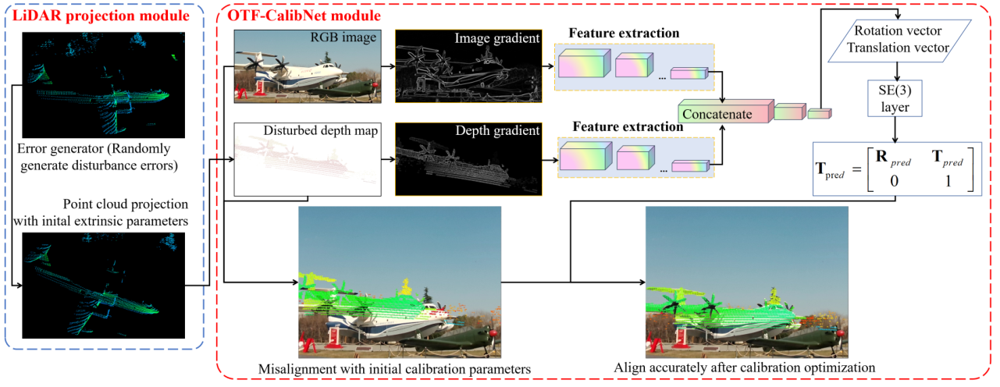
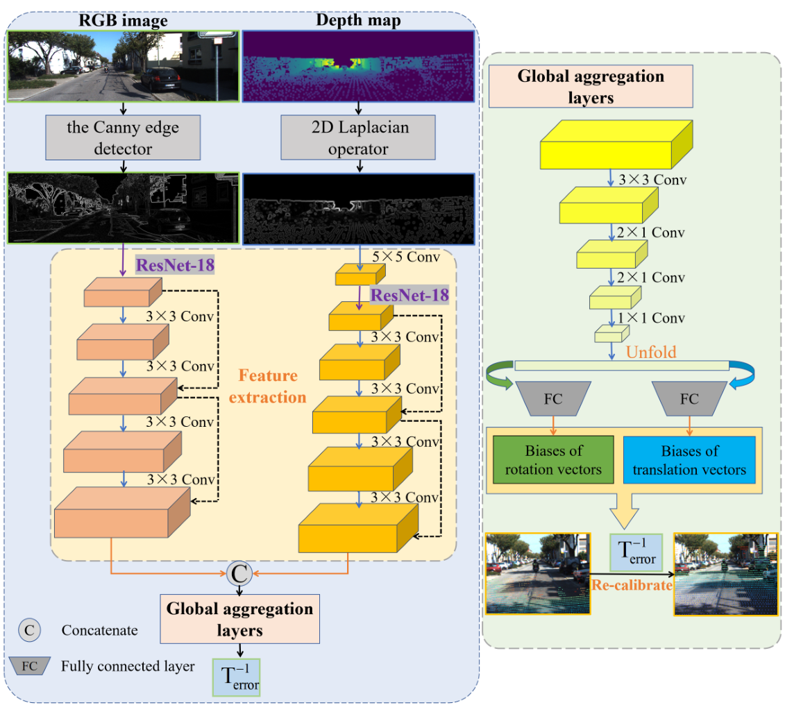
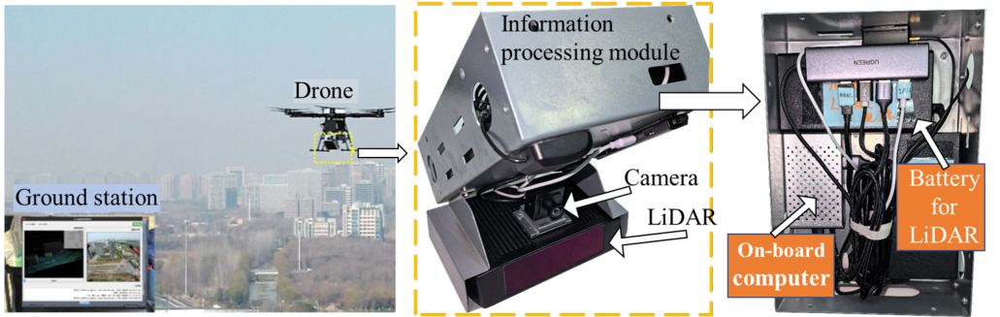
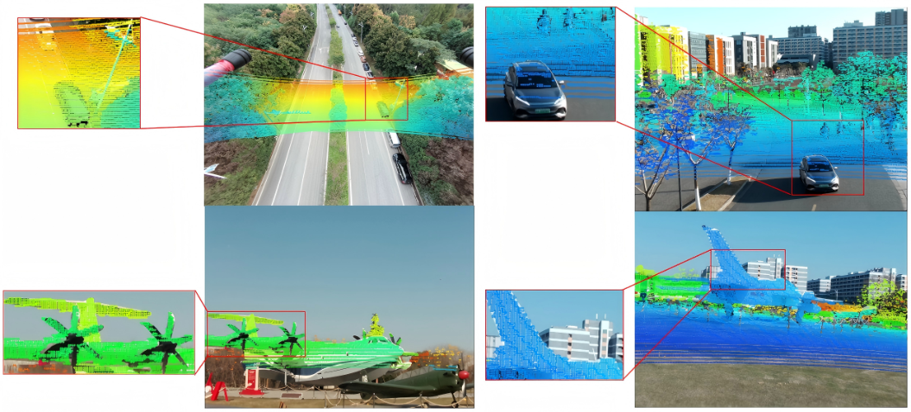

# OTF-CalibNet: Single-Frame Extrinsic Refinement for Synchronous LiDAR-Camera Systems

OTF-CalibNet estimates a rotation correction and a translation correction from
one synchronized image–point-cloud pair. It uses synthetic perturbations for
supervised training. Inference uses one forward pass and no calibration target.
Continuous physical sensor drift and embedded-platform performance are not evaluated.

<p align="center">
  <a href="assets/figures/overview.png"></a>
</p>

*Method overview. A synchronized RGB–LiDAR pair provides structural inputs for single-frame rotation and translation refinement.*

[Architecture](#inputs-and-network) · [Installation](#installation) · [Training](#training) · [Evaluation](#evaluation-and-synchronized-timing) · [Results](#reported-results)

## Inputs and network

<p align="center">
  <a href="assets/figures/architecture.png"></a>
</p>

*Network architecture. Canny RGB edges and depth Laplacian responses feed asymmetric feature branches and a global aggregation module.*


The dataset and inference pipeline share camera-z depth projection followed by
5×5 max pooling. RGB is converted to grayscale for Canny (thresholds 100/200).
Depth features are absolute 2D Laplacian responses, normalized per image.
Both input maps are single-channel and in [0,1]. There is no second depth
scaling or feature-map pooling before the depth backbone.

The retained residual backbone uses a three-convolution stem, four base
residual stages, and two additional residual blocks (four main convolutions).
RGB/depth output channels are 1024/512; depth branch widths are halved.
The current implementation contains 72,666,934 trainable parameters.
This is the repository's custom ResNet-style implementation, not a drop-in
`torchvision.resnet18`. Convolution and fully connected layers regress an
axis-angle rotation vector (radians) and Cartesian translation (metres).
Only the RGB branch accepts pretraining. Supply the actual compatible backbone
checkpoint: pretrained weights are loaded after initialization and are not overwritten.

## Objective

`calibration_objective.py` implements:

- `DepthGradientLoss`: sum of absolute differences of signed horizontal and
  vertical depth derivatives, comparing corrected and reference depth maps.
  RGB does not enter this loss. Sobel discretization is used for these derivatives;
  it is separate from Canny/Laplacian input preprocessing.
- `SquaredChamferLoss`: bidirectional sums of squared nearest-neighbour distances,
  without a square root or coordinate rescaling. Chunked neighbour search limits
  intermediate memory; runtime remains quadratic in the point count.
- `DirectParameterLoss`: batch mean of the L1 sums over the predicted and target
  rotation-vector and Cartesian-translation components. The target is the inverse
  of the applied perturbation, not the forward disturbance.

Default weights are 0.3, 0.3, 0.4. Spatial and point sums are computed per sample,
then averaged over the batch. A bilinear depth splat permits depth supervision
to backpropagate to the correction. Overlapping contributions are averaged and
camera-z values are used. The formulas do not specify the discrete rasterizer,
Sobel stencil, or occlusion convention; these are explicit implementation choices.

## Installation

Use Python 3.12 with matching PyTorch 2.4.0 / torchvision 0.19.0 builds for your
CUDA runtime. Install other dependencies with `pip install -r requirements.txt`.
No model weights are downloaded at module import.

## Dataset and configuration

Organize KITTI odometry under `data/sequences/00`, ..., `data/sequences/21`,
with each sequence containing `image_2`, `image_3`, `velodyne`, and `calib.txt`.
`config.yml` selects 00–15 for training, 16–19 for validation, and 20–21 for testing.
Reported pair counts are 31,176 / 9,004 / 3,553 (43,733 total).

Sequence IDs alone do not identify the exact retained frames. Supply the original
frame-selection JSON through `dataset.frame_manifest`, mapping zero-padded sequence
IDs to original frame indices, e.g. `{"00": [0, 1, 4], "01": [2, 3]}`. The loader
checks actual split counts and does not silently trim or duplicate data to reach
the reported totals. `--allow_count_mismatch` explicitly allows diagnostic runs
on a different subset. A sequence-aware sampler prevents mixed image sizes and
keeps incomplete batches rather than dropping frames.

The self-collected dataset is described as 13,923 pairs, split by acquisition
sequence in a 7:2:1 ratio. Its raw files, exact split manifest, and calibration
metadata are not included; a dataset adapter and sequence manifest are needed to use it.
The reported 640×480 image size belongs to that acquisition system. KITTI image
size follows the loaded files and explicit `--resize_ratio`.

<p align="center">
  <a href="assets/figures/sensor-system.png"></a>
</p>

*Self-collected data acquisition system shown in the paper.*

## Training

```bash
python train_otf.py --config config.yml --dataset_path ./data \
  --backbone_checkpoint /path/to/rgb_backbone.pth \
  --max_deg 10 --max_tran 0.25 --alpha 0.3 --beta 0.3 --gama 0.4
```

Use `--from_scratch` only for a diagnostic run without RGB pretraining.
Learning rate, epochs, point sampling and batch size are configurable through
command-line arguments. Checkpoints include configuration, preprocessing settings,
and `implementation_version`. Resume requires matching configuration.
Use checkpoints with matching architecture and preprocessing versions.

## Evaluation and synchronized timing

```bash
python test_otf.py --config config.yml --dataset_path ./data \
  --pretrained checkpoint/single_frame/best.pth --max_deg 10 --max_tran 0.25
```

For the smaller perturbation setting use `--max_deg 1 --max_tran 0.1`.
The test split is read from configuration. All selected frames are processed
unless `--max_frames` is explicitly supplied. CUDA is synchronized before and
after each measured interval. Evaluation disables autograd and uses one forward pass.

- Network timing: prepared device-resident input maps to the device-resident
  six-component correction vector, including concatenation.
- Calibration-pipeline timing: dataset-prepared CPU RGB and perturbed point cloud
  to the same output, including transfers, projection, pooling and preprocessing.
- Excluded: disk I/O, decoding, resizing, sampling, perturbation generation,
  output transfer, correction-matrix conversion, metrics and visualization.

The two intervals are measured separately. Their difference is not a direct
measurement of preprocessing cost. Output files contain per-frame errors,
latency samples, statistics, device/software metadata and actual evaluated counts.
Rotation metrics use XYZ Euler-angle differences; translation metrics compare
inverse-transform translations. Axis means and vector L2 means are reported
separately. Euler convention and table aggregation must match the original
experiment configuration for a controlled comparison.

## Coordinate and output conventions

Point clouds passed to `project_depth` are expressed in the camera coordinate
system and have shape `[B,3,N]`. Intrinsics are `[3,3]` or `[B,3,3]`.
The model returns two `[B,3]` tensors: an axis-angle rotation vector in radians
and Cartesian translation in metres. `correction_matrix` forms the transform
that maps the perturbed cloud toward its reference. For an initial extrinsic
matrix `T_initial`, the refined matrix is `T_correction @ T_initial`.

Evaluation checks the saved Canny settings, preprocessing version, camera,
voxel size, pooling and field-of-view extension. It uses the checkpoint's
image-resize ratio. Test sequences, perturbation magnitude and point sampling
remain evaluation options; record these when comparing runs.

`latency.csv` contains `frame,network_ms,pipeline_e2e_ms`.
`latency_summary.json` contains timing statistics, input settings and device
metadata. `errors.npy` stores six absolute component errors per frame:
XYZ Euler rotation errors in radians followed by inverse-transform translation
errors in metres. Warm-up calls are excluded from timing statistics.

## Reported results

<p align="center">
  <a href="assets/figures/alignment-results.png"></a>
</p>

*Qualitative alignment examples from the paper, using refined calibration parameters. Click any figure to open it at full size.*


| Initial perturbation | Mean rotation error | Mean translation error |
| --- | --- | --- |
| ±10°, ±25 cm | 0.193° | 2.87 cm |
| ±1°, ±10 cm | 0.018° | 0.21 cm |

Reported mean latencies are 15.27 ms for network inference and 24.76 ms for the
calibration pipeline on the stated workstation. These values are measurements reported in the paper; measured runtime depends
on the hardware, input size and software environment. Literature baselines are quoted
from their publications and are not reproduced under a common protocol.

## Checks

```bash
python -m unittest discover -s tests -v
```

The tests check signed gradient supervision, the squared Chamfer formula,
inverse-correction targets, preprocessing shapes, and nonzero depth-loss gradients.
Training and evaluation require dataset files and the relevant checkpoints.
CUDA timing requires a CUDA-enabled PyTorch build and GPU.
